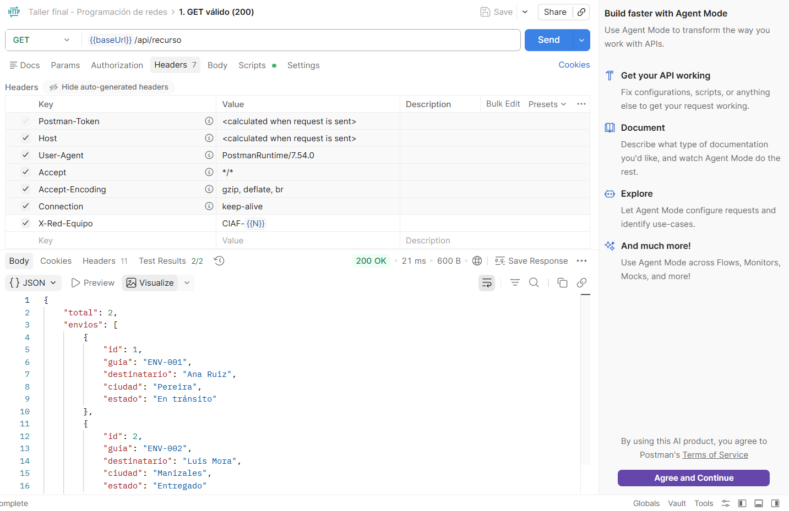
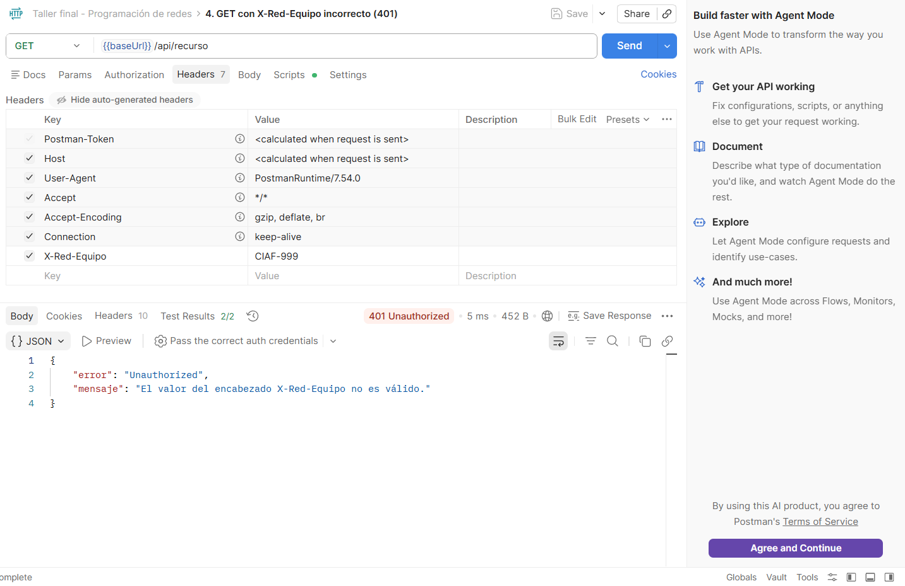

# Taller final – Programación de redes (CIAF)

API REST en Node.js y Express para **consultar y registrar envíos** de una empresa de mensajería.

## 1. Equipo

Integrantes ordenados alfabéticamente por apellido, según el listado oficial (Grupo 1, miércoles):

| N.º de lista | Apellidos y nombres |
|---|---|
| 13 | Lopez Zapata Jairo Alejandro |
| 22 | Peña Sulvaran Ilbar Steven |
| 26 | Torres Hernandez German Ricardo |

- **N** = 13
- **Encabezado de petición:** `X-Red-Equipo: CIAF-13`
- **Encabezado de respuesta:** `X-Servidor-Procesado: Equipo-13`

## 2. Escenario de red

Una empresa de mensajería necesita que sus puntos de atención registren envíos y consulten en qué estado están.

**Cliente:** un navegador web con la página de la empresa, servida desde `http://localhost:5500`. En las pruebas, Postman hace el papel de cliente.

**Riesgos si viaja por HTTP sin cifrar:**

- **Espionaje:** alguien en la misma red (por ejemplo, un Wi-Fi público) podría capturar el tráfico y leer nombres, ciudades y guías.
- **Robo de la credencial:** `X-Red-Equipo` viaja en texto plano; quien lo capture puede hacer peticiones como si fuera del equipo.
- **Modificación:** un intermediario podría cambiar la ciudad o el estado de un envío sin que se note.
- **Suplantación:** el cliente no puede comprobar que habla con el servidor verdadero.

## 3. Instalación y ejecución

Requiere Node.js 18 o superior.

```bash
npm install
npm start
```

El servidor queda en `http://localhost:3050`.

| Método | Ruta | Descripción | Éxito |
|---|---|---|---|
| GET | `/api/recurso` | Lista los envíos | 200 |
| GET | `/api/recurso?guia=ENV-001` | Consulta un envío | 200 |
| POST | `/api/recurso` | Registra un envío | 201 |

Cuerpo del POST (`estado` es opcional):

```json
{ "destinatario": "Marta Gil", "ciudad": "Armenia", "estado": "Registrado" }
```

Errores: `401` encabezado ausente o incorrecto, `400` datos no válidos, `404` guía o ruta inexistente. Los datos se guardan en memoria y se reinician con el servidor.

## 4. Encabezados y CORS

El middleware `validarEquipo` compara `X-Red-Equipo` con `CIAF-N`. Si falta o no coincide exactamente, responde 401 con un JSON que explica el motivo.

Encabezados que devuelve el servidor en una respuesta exitosa:

| Encabezado | Valor | Para qué sirve |
|---|---|---|
| `Access-Control-Allow-Origin` | `http://localhost:5500` | Único origen cuyo JavaScript puede leer la respuesta |
| `Access-Control-Expose-Headers` | `X-Servidor-Procesado` | Permite que ese JavaScript lea el encabezado propio |
| `X-Servidor-Procesado` | `Equipo-13` | Indica qué equipo procesó la petición |
| `Content-Type` | `application/json; charset=utf-8` | Formato del cuerpo |

### ¿Qué problema resuelve CORS?

Por seguridad, el navegador no deja que una página lea respuestas de otro origen (protocolo + dominio + puerto). Nuestra página está en el puerto 5500 y la API en el 3050, así que son orígenes distintos y la lectura estaría bloqueada. CORS permite que el servidor autorice a nuestra página sin abrirse a todas.

Como usamos un encabezado personalizado, el navegador manda antes una petición **preflight** (`OPTIONS`) preguntando si puede enviarlo. El servidor responde 204 con los métodos y encabezados permitidos. Por eso el middleware `cors` está antes de la validación de credencial.

CORS **lo aplica el navegador**, por eso Postman recibe la respuesta desde cualquier origen. No reemplaza la autenticación: para eso está el 401.

## 5. Viaje de la petición en TCP/IP

Ejemplo: `GET http://localhost:3050/api/recurso` desde Postman.

| Capa TCP/IP | Capas OSI | Qué ocurre | Unidad |
|---|---|---|---|
| **Aplicación** | 7, 6 y 5 | Postman arma el mensaje HTTP: método `GET`, ruta, y encabezados `Host` y `X-Red-Equipo: CIAF-13` | Datos |
| **Transporte** | 4 | TCP abre la conexión (SYN, SYN-ACK, ACK) entre un puerto temporal del cliente y el 3050, y numera los datos para que lleguen completos y en orden | Segmento |
| **Internet** | 3 | IP agrega las direcciones de origen y destino. `localhost` es `127.0.0.1` (o `::1` en IPv6) | Paquete |
| **Acceso a red** | 2 y 1 | Entre dos equipos, el paquete iría en una trama Ethernet o Wi-Fi con direcciones MAC. En nuestra prueba usa la interfaz **loopback**, sin salir a la red física | Trama / bits |

En el servidor ocurre lo contrario: se desencapsula de abajo hacia arriba hasta entregar los datos al proceso de Node. Express ejecuta en orden `cors` → `validarEquipo` → `express.json` → endpoint, y la respuesta regresa por el mismo camino.

## 6. ¿Qué protege SSL/TLS (HTTPS)?

HTTPS es HTTP dentro de un canal TLS. Después de conectar por TCP, cliente y servidor negocian claves (*handshake*) y el servidor presenta su certificado. En nuestro caso protege:

- **Confidencialidad:** la ruta, los encabezados (incluida la credencial `CIAF-13`) y el JSON viajan cifrados.
- **Integridad:** si alguien altera el mensaje en el camino, se detecta y se descarta.
- **Autenticidad:** el certificado permite comprobar que el servidor es el legítimo.

No oculta las direcciones IP ni los puertos, ni corrige errores de la propia API. Este taller corre en HTTP local; en producción se publicaría con HTTPS y la credencial debería ser un secreto difícil de adivinar.

## 7. Pruebas en Postman

Importar `postman/coleccion-envios.postman_collection.json`. La variable `N` de la colección debe coincidir con la de `server.js`.

1. GET válido (200)
2. POST válido (201)
3. GET sin encabezado (401)
4. GET con encabezado incorrecto (401)
5. POST con datos incompletos (400)
6. Verificación de encabezados de respuesta
7. Preflight CORS (204)

### Capturas

**Respuesta exitosa con los Headers de respuesta visibles:**



**Respuesta 401 al omitir el encabezado:**


